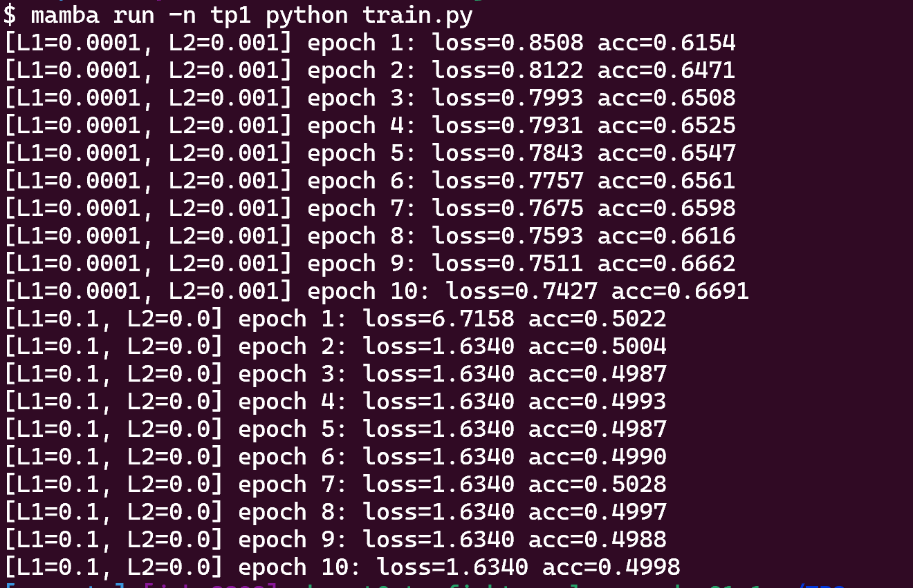
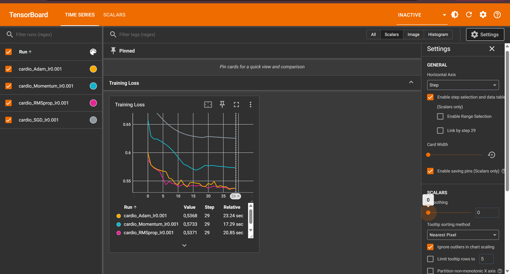
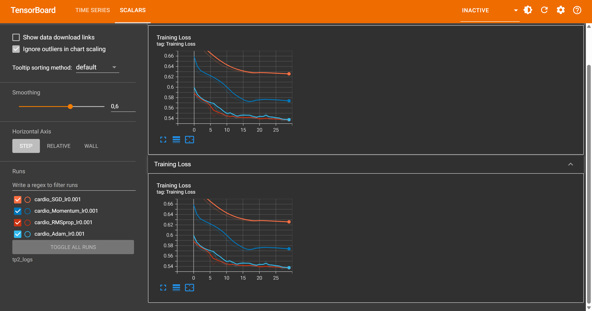
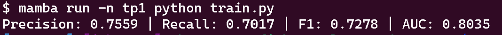

# TP2 – Régularisation, optimisation et métriques

## Exercice 1

### Question 1

C'est une fuite de données. La moyenne et l'écart-type utilisés pour normaliser sont calculés sur tout le dataset, donc en partie sur les données de validation et de test. Des informations sur ces données se retrouvent ainsi dans le prétraitement de l'entraînement. Les performances mesurées sont alors trop optimistes, et le modèle risque de décevoir sur des données réellement nouvelles.
Il faut découper d'abord le dataset, faire le fit du scaler uniquement sur le train, puis appliquer ce même scaler au val et au test.

### Question 2

On utiliserait torch.utils.data.IterableDataset, qui lit les données en flux au lieu de tout charger en mémoire. On peut le combiner avec `num_workers` dans le `DataLoader` pour paralléliser la lecture.

## Exercice 2

Sortie du script `train.py` avec les deux réglages (10 epochs, SGD, lr = 0.01) :

### Question 1

| Réglage | Loss (epoch 1 → 10) | Précision (epoch 1 → 10) |
|---|---|---|
| L1 = 1e-4, L2 = 1e-3 | 0.8508 → 0.7427 | 0.6154 → 0.6691 |
| L1 = 0.1, L2 = 0 | 6.7158 → 1.6340 (bloquée dès l'epoch 2) | ≈ 0.50 (aucune progression) |

Avec `l1_lambda = 0.1`, la loss ne diminue plus après l'epoch 2 et reste figée à 1.6340. La précision oscille autour de 50 %, ce qui correspond au hasard sur un dataset à peu près équilibré. Le réseau n'apprend plus rien.

La pénalité L1 domine la loss totale : pour la réduire, l'optimiseur pousse tous les poids vers 0 plutôt que d'améliorer la prédiction. Le modèle devient trop contraint pour représenter les données. Ce phénomène s'appelle le **sous-apprentissage** (*underfitting*).

### Question 2

`weight_decay`.

### Question 3

- **L1** favorise des poids **parcimonieux**. Beaucoup de poids sont ramenés exactement à 0, ce qui revient à une sélection implicite de variables.
- **L2** **réduit l'amplitude de tous les poids** de façon uniforme. Ils deviennent petits mais rarement nuls, et la valeur est répartie sur l'ensemble des poids.

## Exercice 3

Courbes de Training Loss des 4 optimiseurs

Même graphique avec un lissage de 0.6

Valeurs finales de la loss et temps d'entraînement relevés dans TensorBoard:

| Optimiseur | Loss finale | Temps |
|---|---|---|
| Adam | 0.5368 | 23.24 s |
| RMSprop | 0.5371 | 20.85 s |
| Momentum | 0.5733 | 17.29 s |
| SGD | ≈ 0.625 | – |

### Question 1

RMSprop et Adam convergent plus vite que les deux autres : leur loss passe sous 0.55 en une quinzaine d'epochs, alors que Momentum et SGD restent au-dessus. RMSprop est très légèrement en avance sur Adam sur les premières epochs et les deux finissent presque au même niveau. Ces optimiseurs adaptent le pas d'apprentissage pour chaque paramètre, ce qui accélère la descente.

### Question 2

Momentum converge plus vite que SGD simple : à l'epoch 29, sa loss est de 0.5733 contre environ 0.625 pour SGD, et elle part aussi plus bas dès les premières epochs. Le moment accumule une moyenne des gradients passés : il accélère la descente dans les directions où le gradient est stable et amortit les oscillations. On voit toutefois une légère remontée de la courbe Momentum autour de l'epoch 15, signe que l'élan peut faire dépasser un minimum local avant de revenir.

## Exercice 4

Résultats du meilleur modèle, Adam, sur l'ensemble de test :

| Precision | Recall | F1 | AUC |
|---|---|---|---|
| 0.7559 | 0.7017 | 0.7278 | 0.8035 |

### Question 1

- **Précision** = TP / (TP + FP) : parmi les patients prédits malades, la proportion qui l'est réellement.
- **Rappel** = TP / (TP + FN) : parmi les patients réellement malades, la proportion détectée par le modèle.

### Question 2

On privilégie plutôt un **fort rappel**. Un faux négatif (un malade non détecté, donc non soigné) est beaucoup plus grave qu'un faux positif (un patient sain envoyé passer des examens complémentaires). On accepte donc plus de fausses alertes pour manquer le moins de malades possible, tout en surveillant la précision (via le F1) pour ne pas submerger les médecins.

Ici, le rappel est de 0.70 : environ 30 % des patients malades ne sont pas détectés, ce qui est élevé pour un usage médical. On pourrait l'améliorer en abaissant le seuil de décision en dessous de 0.5, au prix d'une précision plus faible.

### Question 3

L'aire sous la courbe ROC mesure la capacité du modèle à **classer** les patients malades avant les patients sains, sur **tous les seuils possibles**, alors que précision, rappel et F1 dépendent d'un seuil fixe (ici 0.5). Elle permet de comparer des modèles sans choisir de seuil, puis d'ajuster ensuite ce seuil selon le compromis voulu entre précision et rappel. Ici, une AUC de 0.80 indique une bonne capacité de discrimination.